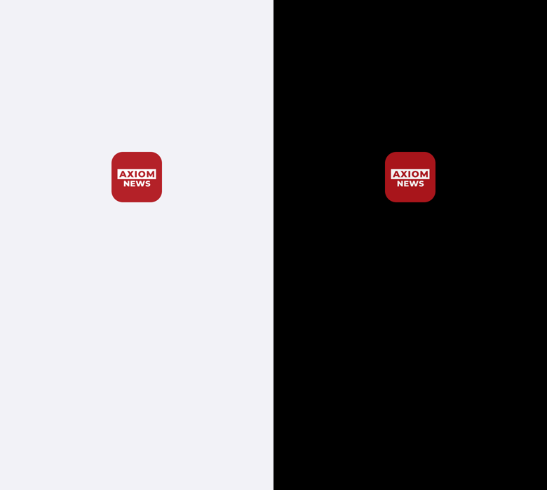
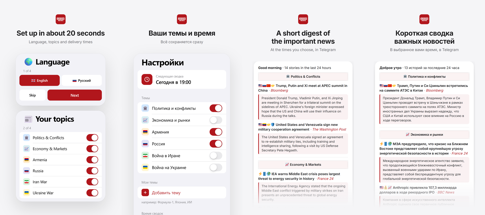
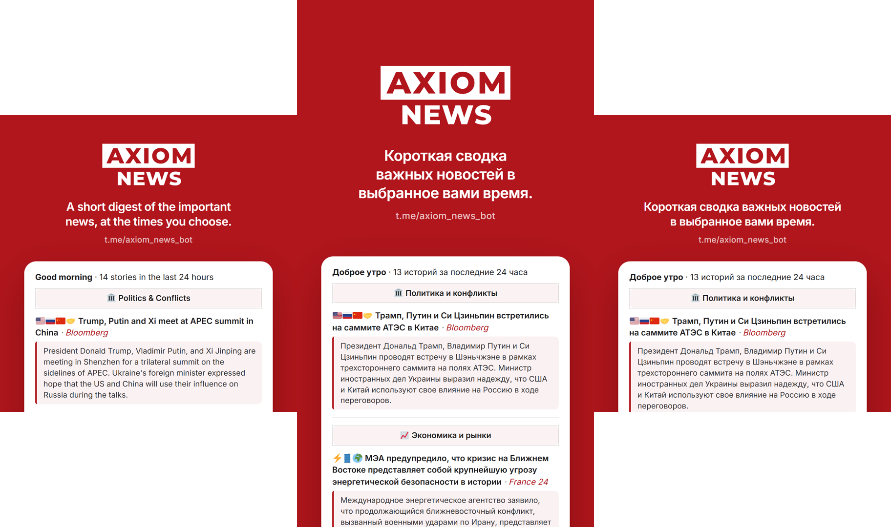

# Step 17b: branding before launch

Status: round 2 (owner remarks) live on staging and the TEST bot (Worker version c497a9e0, code
72bd0511bc080f86). Waiting for the owner's OK on his phone. Production is untouched; it gets this at the launch switch.

## What changed in one look
- The existing Axiom News logo rebuilt as a sharp vector (it existed only as Telegram's 320 px JPEG).
- New about, description, welcome and reminder texts (owner's wording, in en and ru; hy and fr in the
  same tone for when they are switched on).
- The welcome is now one message: a 2 s logo animation, the text as its caption, and ⚙️ Set up.
- The Mini App's loading screen is the logo with a slow fade, light and dark (no spinner).
- Calmer wording everywhere else (list below).
- Files for BotFather (description animation, profile photo, loading icon, profile previews) and share cards.

## Round 2 (owner remarks, 2026-11-19)
- New description and about in the owner's words (en, ru; hy and fr in the same tone). No count of
  sources any more; the named outlets are all enabled feeds: Financial Times (3 feeds), The Economist
  (4), Bloomberg (3), The Wall Street Journal (2), Al Jazeera (1).
- Welcome, second line: "...at the times you choose" / "...в выбранное вами время".
- Gone from every user-facing text, Help included: "a few times a day" (also in `bot.help_new`, the
  preview and share-card lines), "English or Russian", News.am, RFE/RL. Help keeps "We read about 100
  outlets every hour" (123 feeds from 98 outlets).
- Lengths (Telegram: description 512, about 120): description en 356, ru 346, hy 357, fr 361; about
  en 87, ru 85, hy 84, fr 102.
- Splash icon: BotFather refused `loading-icon.svg` (it wants a single path). New
  `branding/out/splash-icon.svg`, made by `branding/source/build_splash.py`: one `<path>` and nothing
  else (no rect, group, text, transform or stroke), one colour (#b1161c), `fill-rule="evenodd"`, square
  viewBox 0 0 1024 1024, integer coordinates, 1,807 bytes. The script checks the element list is exactly
  svg + path. The logo is flattened with boolean operations (skia-pathops): the rounded square, minus
  the bar, plus the AXIOM letters, minus the NEWS letters, so the white parts are holes. Rendered check
  below: on the light splash it looks like the logo; on the dark splash the holes show the dark
  background, so the bar and NEWS look black (a one-colour icon cannot have white).
- Test rule: bot reply lines may be 90 characters (the new English welcome line is 83).

## Assets
| Asset | Path | Where it shows | Spec |
|---|---|---|---|
| Logo (vector) | `branding/source/logo.svg`, `logo-icon.svg`, `logo-lockup.svg` | everything below | outlines, no font needed |
| Profile photo | `branding/out/profile-photo-1280.png` (and `-640`) | bot avatar | square PNG, 35 KB |
| Description animation | `branding/out/description-640x360.mp4` (`-320x180.mp4`, still `-640x360.png`) | empty chat, before Start | 3 s, H.264, no sound, 32 KB |
| Welcome animation | `worker/public/media/welcome.mp4` (= `branding/out/welcome-1280x720.mp4`) | with the welcome message | 2 s, 1280x720, no sound, 49 KB |
| Loading screen | `worker/public/app/index.html` + `app.css` | every Mini App open, until settings load | inline SVG, 2.6 KB |
| Splash icon for BotFather | `branding/out/splash-icon.svg` (PNG check `splash-icon-512.png`) | Telegram's own Mini App loading screen | one path, 1.8 KB |
| Profile previews | `branding/out/preview-{en,ru}-{setup,settings,digest}.png` | bot profile, under Launch app | 1080x1920 PNG |
| Share cards | `branding/out/share-{en,ru}-1080x1080.png`, `-1080x1920.png` | for the owner to post | PNG |

How they are made: `branding/README.md`. Telegram's documented limits: description up to 512
characters (ours: en 370, ru 376), about up to 120 (en 77, ru 84), description picture 640x360 (BotFather
sometimes asks 320x180 for an animation, so both are made), animations are soundless H.264 MP4 (Telegram
turns GIFs into these anyway; a URL send may be up to 20 MB).

### The logo against the original
Left the original JPEG, middle the rebuild, right the two overlaid (difference: only edge hairlines).
The red is the brand red #b1161c (the old JPEG was a lighter #bf1a1e).

At Telegram's avatar sizes (42, 54, 120 px; the last one is the old photo):

### The motion (description animation, every 6th frame)

### Loading screen (light, dark)

### Profile previews

The setup and Settings shots are the real Mini App (its own code and styles) on the local preview with
demo data. The digest is a real digest from staging (19 Nov, dry run), shown the way Telegram shows a
rich message; only the preview label and the owner's first name were removed. Emoji in these images
are Twemoji (Windows cannot draw colour flag emoji); on phones Telegram uses its own.

### Share cards

## Text changes
New (owner's wording): `bot.short_description` (about), `bot.description`, `bot.welcome_setup`,
`bot.setup_button` (now "⚙️ Set up" / "⚙️ Настроить"), `bot.reminder` (no name or times any more).

Changed for tone (en and ru, the same in hy and fr):
| Key | Before | Now |
|---|---|---|
| `bot.help_new` | 👋 Hi! Send /start to begin. / 📰 I send short news digests... | 👋 Send /start to begin. / 📰 Axiom News sends a short digest of the important news at the times you choose. |
| `bot.welcome_back`, `welcome_new` | ... {name}! | ... {name}. |
| `bot.support` | ...it stays free. ⭐ Like it? You can leave a tip... 🔓 Nothing is locked. | ...will remain free. ⭐ You can leave a voluntary tip... 🔓 A tip unlocks nothing and changes nothing. |
| `bot.tip_thanks` | Thank you for your tip of 250 ⭐! | Thank you for your tip of 250 ⭐. |
| `bot.paysupport_sent` | ✅ Thank you! Your note was sent. | ✅ Thank you. Your note has been sent. |
| `bot.paysupport`, `bot.terms` (en) | can't | cannot |
| `bot.tip_description` | ...that keeps Axiom News running. Axiom stays free... | ...towards running Axiom News. Axiom News remains free... |
| `digest.sample_label` | the top news of the last 24 hours | the important news of the last 24 hours |
| `errors.server`, `app.generic_error` | 😕 Something went wrong. | ⚠️ Something went wrong. Please try again. |
| `app.help_what` | A short digest of the top news. ... Free for everyone. | A short digest of the important news. ... Free, no ads. |
| `app.help_stories` | We read 120 news sources every hour. | We read about 100 outlets every hour. |
| `app.help_support` | Like it? Leave a tip in Telegram Stars. | Tips in Telegram Stars are voluntary. |
| `app.feedback_placeholder` | Ideas, problems, anything 💬 | Ideas, problems, questions |
| `app.feedback_thanks` | ✅ Thank you! | ✅ Sent. Thank you. |
| `app.setup_sample` | A sample digest is on its way. It has the top news... (ru "уже летит к вам") | A sample digest will arrive shortly. It covers the important news... |

Kept: "сводка", "на Украине", every setting label, the quiet note ("Quiet period: nothing important on
your topics"), feedback and error texts that were already short and plain. No em or en dash anywhere.

## Code
- `worker/src/bot.js` `sendWelcome`: the welcome is `sendAnimation` (the file by URL, the caption in
  HTML, the button). If Telegram refuses the animation, the same text and button go as a message and the
  failure is logged; a blocked reader gets no second try.
- `worker/src/index.js`: the animation's address is next to the Mini App (`/media/welcome.mp4`).
- `worker/src/onboard.js`: the reminder is the new HTML text (no name, no times).
- Mini App: the loader markup is in `index.html` (it paints before any script), reused on a retry;
  reduced motion shows it still.

## Checks
- Worker tests: 307 pass (2 new: the animation fallback, the blocked reader). Python: 169 pass.
- Mini App click-through (`worker/scripts/ui-check.mjs`): 140 of 140 pass.
- `AXIOM_ENV=staging node scripts/api-check.mjs`: pass. `AXIOM_ENV=staging node scripts/setup-bot.mjs`:
  the TEST bot shows the new description and about in en and ru.
- Staging serves `/media/welcome.mp4` (200, video/mp4); the TEST bot sent it by URL to the owner.
- One line test rule changed: bot reply lines may be 90 characters (was 75), because the owner's
  approved English welcome has an 83-character line.
- Round 2: Worker tests 307 pass; api-check on staging 9 pass, 0 fail; setup-bot reads back the new
  description in en and ru. The Mini App itself did not change in round 2 (stamps unchanged).

## Waiting on the owner
1. Check on his phone (message on the TEST bot): empty chat, welcome, reminder, loading screen, texts.
2. BotFather on the TEST bot (taps sent in the chat, and below): description animation, profile photo,
   Main Mini App with the staging address, previews.
3. Say OK (or what to change). Then this goes into the launch switch.

## Launch switch: production is @axiom_news_bot (prepared, not applied)
Order: the real bot's token as production's secret, `SHIP_IT=yes npm run deploy:prod` (carries the
texts, the welcome animation and the loading screen), then `node scripts/point-bot.mjs` and
`node scripts/setup-bot.mjs` in `worker/` without AXIOM_ENV (menu button, commands, description and
about in en and ru, read back and checked). The description and about texts come from setup-bot.mjs,
so nobody types them into BotFather.

### What the advisor sets in BotFather for @axiom_news_bot
All files are on the owner's PC under `C:\Users\budag\VS_Code_Projects\Axiom News v2\branding\out\`
(also in the GitHub repo, same path).

| # | BotFather (/mybots, @axiom_news_bot, then) | Set to | File on this PC |
|---|---|---|---|
| 1 | Edit Bot > Edit Description Picture | the 3 s description animation (640x360 MP4, no sound, 32 KB). If it asks for 320x180, the small one; if it takes only a picture, the PNG | `C:\Users\budag\VS_Code_Projects\Axiom News v2\branding\out\description-640x360.mp4`; fallbacks `...\branding\out\description-320x180.mp4`, `...\branding\out\description-640x360.png` |
| 2 | Edit Bot > Edit Botpic | the profile photo, sent as a photo | `C:\Users\budag\VS_Code_Projects\Axiom News v2\branding\out\profile-photo-1280.png` |
| 3 | Bot Settings > Configure Mini App > Enable Mini App | Main Mini App address `https://axiom-news.axiom-news-worker.workers.dev/app/` | |
| 4 | Configure Mini App > launch / display mode | **Full size** (not compact, not fullscreen) | |
| 5 | Configure Mini App > loading screen: icon | the single-path splash icon | `C:\Users\budag\VS_Code_Projects\Axiom News v2\branding\out\splash-icon.svg` |
| 6 | Configure Mini App > loading screen: colours | light background `#f2f2f7`, dark background `#000000` (the Mini App's own backgrounds, so there is no flash when it opens) | |
| 7 | Bot profile in Telegram > Add preview (default language) | 3 previews in this order | `C:\Users\budag\VS_Code_Projects\Axiom News v2\branding\out\preview-en-setup.png`, `...\preview-en-settings.png`, `...\preview-en-digest.png` |
| 8 | Same place, language Russian | 3 previews in this order | `C:\Users\budag\VS_Code_Projects\Axiom News v2\branding\out\preview-ru-setup.png`, `...\preview-ru-settings.png`, `...\preview-ru-digest.png` |

Not in BotFather: the welcome animation is served by the Worker
(`C:\Users\budag\VS_Code_Projects\Axiom News v2\worker\public\media\welcome.mp4`, at
`https://axiom-news.axiom-news-worker.workers.dev/media/welcome.mp4` after the production deploy).

Then check from another account: the empty chat (description and animation), the profile (photo,
about, Open app, previews), Start, the welcome with the animation, and opening the Mini App (splash,
then the logo fade).

## Invite for the owner (not sent)
English:
> 📰 I have launched Axiom News, a Telegram bot that sends a short digest of the important news at the times you choose.
> 🗂 You pick the topics, including your own.
> 🌐 Available in several languages.
> 👉 t.me/axiom_news_bot

Russian:
> 📰 Я запустил Axiom News: это Telegram-бот, который присылает короткую сводку важных новостей в выбранное вами время.
> 🗂 Темы выбираете вы, включая свои собственные.
> 🌐 Доступно на нескольких языках.
> 👉 t.me/axiom_news_bot
