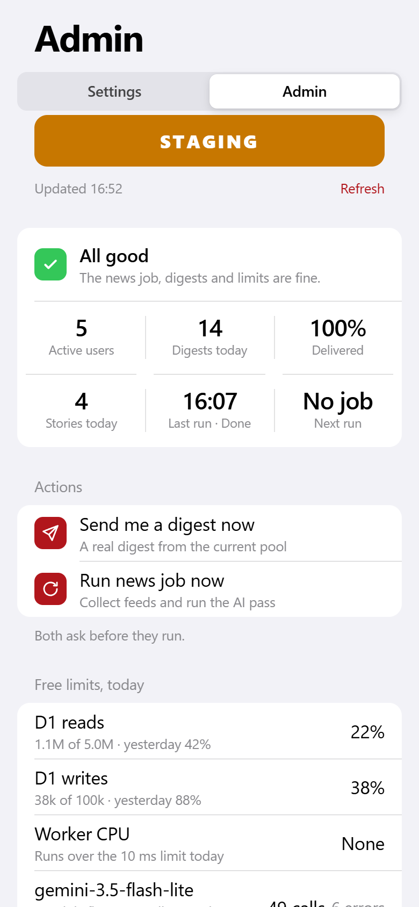
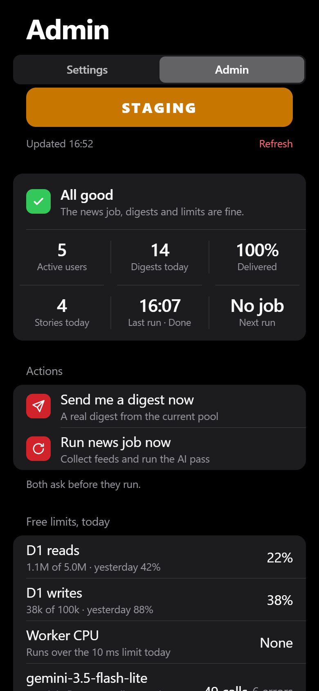
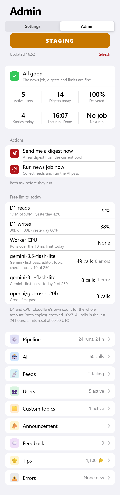
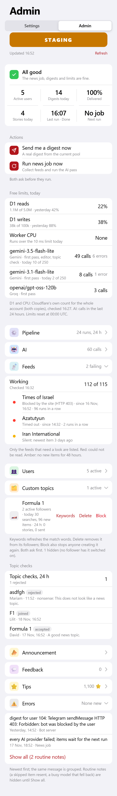
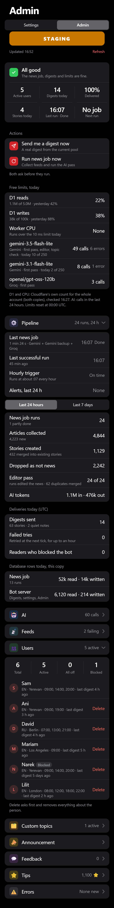
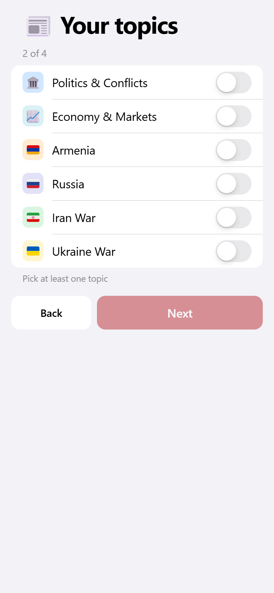
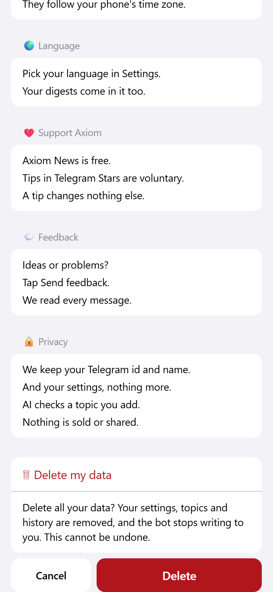

# Step 18: beta fixes (2026-11-20)

Six owner changes, built, tested, deployed to staging, then to production (the owner pre-approved
"ship it" for the whole list). Commit b5ad73d. Staging Worker 2c91604f, production Worker fddcebbf.

## What changed
1. **Setup, topics step.** Every topic starts off. Next stays disabled until one topic is on, with one
   hint line, "Pick at least one topic" (in every language). Skip still applies the defaults: the server
   puts the six main topics back on in the same statement that ends the setup. Readers who never open
   the Mini App keep the defaults, as before.
2. **Help wording.** No "the owner" anywhere a reader can see: "We read every message" (and the same in
   Russian, French, Armenian). The owner-only texts now say "your Admin account". A test fails if
   "owner" (or its translations) comes back into any Mini App text.
3. **Delete my data** is in the brand red (#b1161c; dark mode text #ff6b6b), not orange. Its question
   now shows in place under the row with Cancel and a solid red Delete (#b1161c, dark #d0232a), since
   Telegram's own popup cannot take our colour. The owner still gets a second question.
4. **Digest times bug.** Details below.
5. **Bot menu.** /support and /paysupport are gone from the visible command list in every language
   (both bots, including the per-chat lists of readers who picked a language). Both still work when
   typed; Support Axiom stays in Settings.
6. **Admin dashboard.** Screenshots below.

Also: staging is silent now (`USER_SENDS = "off"` in `wrangler.toml`), as asked.

## The digest times bug: the real cause
The Mini App sent saves one after another, but each answer **replaced the whole settings data** with
what the server had at that moment, while the buttons on screen kept showing the newer taps. Example
from the click-through test: times 09 and 14; tap 20 on, tap 09 off; the first answer (09, 14, 20)
arrives and overwrites the data; tap 14 off; the second answer (14, 20) arrives; tap 20 off. The data
said two times were left, so the "keep at least one" check let it through, and the screen showed
**zero times**. The server never stored an empty list (it refused it), so after reopening, the owner saw
whatever was really saved, for example 14:00. The same race could hit topics too.

Fixed on both sides:
- **Mini App:** one request at a time; taps made while a request is on its way are merged into the
  next one; an answer never overwrites a tap the server has not seen; the buttons are always drawn from
  the data (so the checks and the screen agree); any error rolls back to the server's state and shows a
  short message.
- **Server:** the save is one `UPDATE ... RETURNING *` statement, and the database itself refuses an
  empty or too long times list (`json_array_length` guard). The answer is the row as written. Every
  refusal now also carries the saved state, so the Mini App can roll back to it.

Proof: the new click-through checks (slow answers, 40 rapid random taps, a failed save) fail on the old
`app.js` (the screen showed zero times while the server had 14:00, exactly the owner's report) and pass
on the new one. Server tests cover the empty list, every refusal, racing requests from two devices and
the SQL guard alone.

## Admin dashboard
- **Top:** one health line, green "All good", amber "Needs a look" or red "Something is wrong", with
  the most serious reason in one line ("+2 more" if there are more). Then six numbers: active users,
  digests today, delivered (%), stories today, last news run, next run.
- **Actions:** Send me a digest now, Run news job now (both still ask first).
- **Free limits, today:** D1 reads and writes (% of the free limit, today and yesterday), Worker CPU
  (runs over 10 ms), AI calls and errors per model (24 h, with today's count against the soft limit).
  Colour only at 70% or more (amber) and 90% or more (red).
- **Sections, closed until tapped:** Pipeline, AI, Feeds (only failing or silent feeds, the rest one
  count), Users (Delete), Custom topics (only active ones, at most "x hidden"; Keywords, Delete,
  Block), Announcement, Feedback, Tips (Refund), Errors (grouped, newest first, routine notes behind
  "Show all").
- Same design as Settings: 48 px rows, 12 px corners, light and dark. Red in Admin is the system red,
  brighter than the brand red; failure badges changed from orange to that red.
- New: a small daily delivery counter (one D1 row, written only by a tick that sent something) for
  "Digests today" and "Delivered". It started at the production deploy (12:47 UTC), so today's numbers
  count from then.

| Top (light) | Top (dark) | Sections closed |
|---|---|---|
|  |  |  |

| Feeds, Custom topics, Errors open | Pipeline and Users open (dark) |
|---|---|
|  |  |

| Setup, topics step | Delete my data |
|---|---|
|  |  |

Screenshots are from the local preview with made-up demo data (`worker/scripts/step18-screenshots.mjs`).

## Tests
- Worker unit tests: 341 pass (19 new in `worker/test/step18.test.mjs`). Python: 177 pass.
- Mini App click-through (`worker/scripts/ui-check.mjs`): 164 pass, at 360, 390 and 430 px, English and
  Russian, light and dark, now with the setup topics step, the times race and rollback, Delete my data in
  both themes, Help wording, and the dashboard (every section open and closed, every action present).
- Staging live check (`AXIOM_ENV=staging node scripts/api-check.mjs`): 11 of 11 pass, including the
  empty list refused with the saved state and the dashboard summary.
- Production: not tested (house rule). Checked read-only: the new Mini App is served, both bots show
  /start, /settings, /terms, cron ticks at 1 to 2 ms CPU.

## Worker CPU (staging, measured with `wrangler tail`)
- `GET /api/admin`: 0 to 6 ms in 12 calls; one call at 14 ms was the first request into a fresh
  isolate right after the deploy. Cloudflare flagged nothing.
- `POST /api/settings`: 1 to 4 ms. `POST /api/open`: 3 to 4 ms.
- Cost: $0; no new services. One extra D1 write per digest tick that sends something.

## For the owner to check
- Admin on your phone: the health line, the numbers, tap a few sections open.
- Settings > Digest times: tap quickly on and off; it should never show zero, and reopening shows the same.
- Help: the Feedback section says "We read every message"; Delete my data is red (do not press Delete).
- The bot's menu (the "/" button): only /start, /settings and /terms.
- The setup flow is only seen by new readers; a friend's first open will show every topic off.

## Waiting on the owner
Nothing blocking. Your check on the phone.
