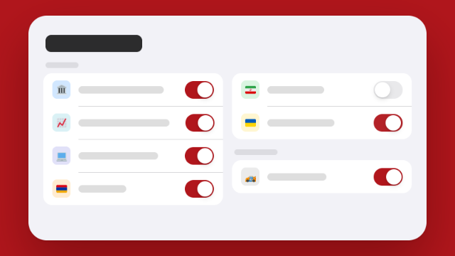
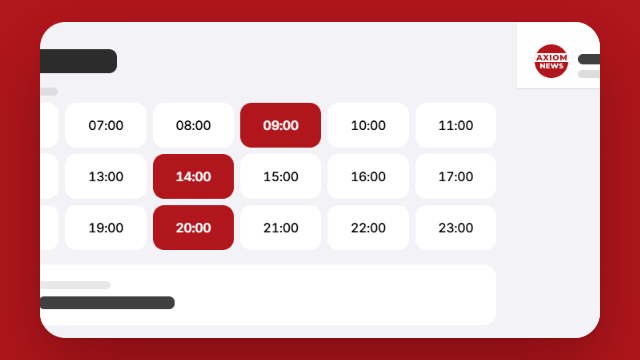
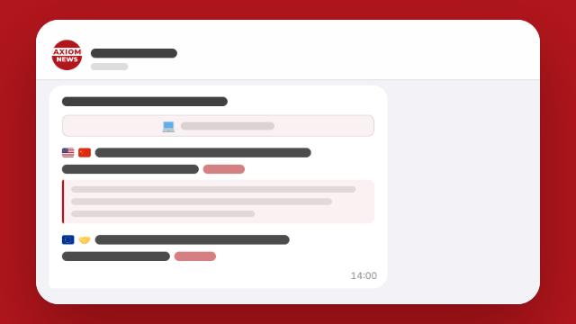
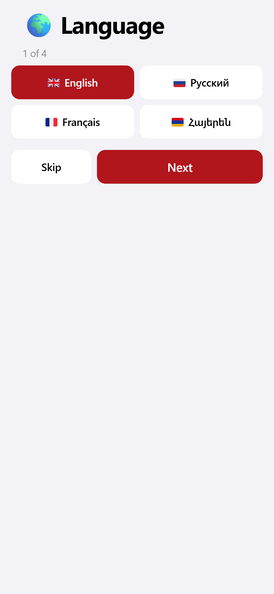
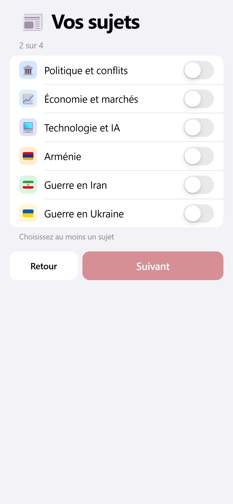
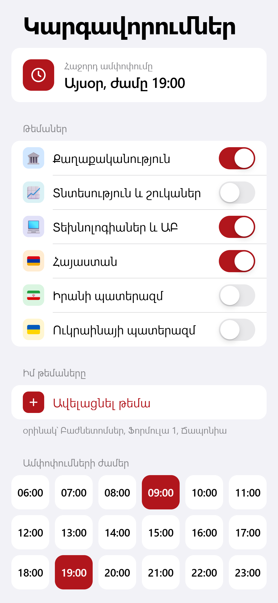
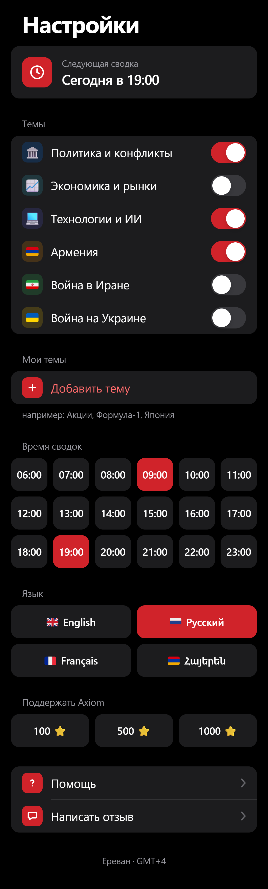

# Step 19: topics, languages, welcome video, alerts, branding (2026-11-23)

Seven parts, built and tested one by one on branch `step-19` (each part committed and pushed), checked on
staging, then shipped together (the owner pre-approved "ship it" for the whole step). Merge `b995fa4`;
production Worker `7c104076`, staging Worker `e2ea0925`. Part details: `reports/step-19-topics.md` (Part 1)
and `reports/step-19-progress.md`.

## What changed for readers
1. **Main topics:** Politics & Conflicts, Economy & Markets, **Technology & AI** 💻 (new), Armenia, Iran War,
   Ukraine War, all six on for a new reader. **Russia is no longer a main topic**; its stories moved to their
   best remaining topic (production: 1,949 stories; 554 to Politics, 117 to Ukraine War, 47 to Economy). The
   three production readers lost Russia and got Technology & AI. Eight tech feeds (FT, Bloomberg, WSJ, NYT,
   The Guardian, MIT Technology Review, Ars Technica, Wired AI).
2. **Own topics are easier:** only a name for a whole main topic is refused (Economy, Markets, Tech,
   Armenian news). Stocks, Finance, Crypto, Oil, AI startups, AI and Russia are normal custom topics
   (checked with the real model).
3. **Four languages:** English, Russian, French, Armenian, in a 2x2 grid in Settings and setup; the bot's
   commands, menu button, description and about in all four.
4. **Welcome video:** the logo animation, then how it works on a wide settings screen (11 s, 222 KB, no words).
5. **Alerts:** no reports; at most one alert per kind a day, each with one "What to do" line. New kinds:
   digests failing, many feeds down, no news run for 2 hours, Google blocking custom topics for a day.
   A daily stats table, never deleted. Backups: Cloudflare keeps 7 days (steps in `OWNER_GUIDE.md`).
6. **Branding:** description, about, Help and every image or video that shows topics or languages, in four
   languages.

## Screenshots
| | |
|---|---|
| Welcome video, 0.9 s (logo)  | 4.5 s (topics switch on)  |
| 7.6 s (times picked)  | 9.6 s (the digest arrives)  |
| Setup, language step, 2x2  | Setup, topics, French  |
| Settings, Armenian (long names fit one row)  | Settings, Russian, dark  |

More: profile previews `branding/out/preview-*.png`, share cards `branding/out/share-*.png`, the whole
marketing kit in `branding/marketing/review.html`.

## Checks
- Tests: Worker 359, Python 185 (new: `worker/test/step19.test.mjs`, `tests/test_step19.py`, the Step 19
  migration test, new health tests).
- Click-through: 248 of 248 checks at 360, 390 and 430 px, English, Russian, French and Armenian, light and
  dark (new: the 2x2 grid in Settings and setup, every language's layout and edit mode).
- Rules broken on purpose: 33 of 33 caught (`venv/Scripts/python scripts/step19_mutations.py`). Three tests
  were too weak at first (an editor example, the Google alert's 24 h, half-English translations) and were
  strengthened before the final run.
- Found and fixed on the way: Armenian topic names wrapped to two lines (now a smaller font, 13 px at least,
  and Armenian "Politics & Conflicts" is just "Քաղաքականություն"); the marketing kits drew Armenian in a poor
  fallback font (now Segoe UI).

## Production check after shipping
Done without test users or test messages on production (CLAUDE.md rule 3):
- The production Worker serves the new welcome video (`/media/welcome.mp4?v=19`, 222,702 bytes), the Mini App
  with `enabled: en, ru, fr, hy` and the four Technology & AI names, and the one-line topic rows.
- Production D1: the topics table is the six new rows in order, all default; 0 stories and 0 users still on
  `russia`; `daily_stats` exists.
- The real bot (`setup-bot.mjs`): commands, menu button, description and about set and read back in en, ru,
  fr, hy (and English with no language code). OK.
- "Stocks" through the production code's topic check with the real model: added as a custom topic; Economy
  and Tech go to the main topics with no AI call.
- **Left for the owner** (needs a real new Telegram account, which only a person has): the new-user flow on
  the real bot. Easiest: Help > Delete my data, then /start. You should get the new video, the setup with
  four languages in a 2x2 grid, the six topics, a sample digest, and "Stocks" should be accepted.

## D1, AI and run times, before and after
Production, read-only. Before: the 24 h up to the ship (24 runs). After: the three runs that started after
the ship (14:07, 15:07 and 16:07 UTC). Per run:

| | Before (average) | After (average) |
|---|---|---|
| Run time | 105 s (longest 353 s) | 519 s (longest 652 s) |
| D1 rows written by the job | 947 | 914 |
| D1 rows read by the job | 23,970 | 22,955 |
| New items | 133 | 238 |
| AI calls by the job | 6.2 | 14 |
| AI tokens in / out | 67,139 / 19,610 | 39,237 / 8,218 |
| Feeds read | 116 | 123 to 125 (the 8 tech feeds) |

**Read the "after" column with care: Google's Gemini has been down since 12:07 UTC, before the ship.** It
answers "HTTP 503, high demand" to every call. The job falls back to Groq, which takes far fewer items a
run. That is why runs are longer (waiting on Gemini, then Groq), why there are more AI calls and fewer
tokens, and why only 6 or 7 new stories were made per run instead of about 90. Unfinished items wait for
the next run: **667 items are pending now** (0 before the outage). When Gemini is back, the next runs will
clear them, with more writes and tokens for a few hours. Two new tech stories were made since the ship.
More new items per run is partly the 8 tech feeds and partly the time of day (the afternoon is busier).

**Translations:** 1 Russian translation since the ship (792 tokens in, 160 out); 26 a day before (36,350 in,
34,792 out). **0 French and 0 Armenian calls**, because no production reader uses those languages yet (2
English, 1 Russian). Measured cost of one reader language: about 26 calls a day. A French and an Armenian
reader would add about 52 calls a day.

**Projected busy day, as % of the free limits:**
- **D1 writes (100,000 a day):** a busy normal day about 43% (the busiest recent day was 42k, plus 500 to 900
  for the tech feeds). Today is about 39,200 by 14:50 UTC; with the one-time migration and staging tests, it
  should end near 48%, still under the 50% line. Yesterday was 17,900 (18%).
- **D1 reads (5,000,000 a day):** today 846,600 so far (17%), about 26% by the end of the day.
- **Gemini (the guard's 250 calls a day per model):** primary model 100 of 250 (40%) in the last 24 h.
  With a French and an Armenian reader, about 152 (61%).

**To watch:** the pending count in Admin. It should fall back to 0 within a few runs once Gemini answers
again. Nothing in Step 19 caused the outage (it began before the ship), and the job keeps running on Groq.

## What the owner must do by hand
See `reports/step-19-progress.md`, "What the owner must redo by hand": BotFather Main Mini App previews in four
languages (`branding/out/preview-<lang>-{setup,settings,digest}.png`), posting the new Instagram assets, and
confirming the Armenian topic name.
